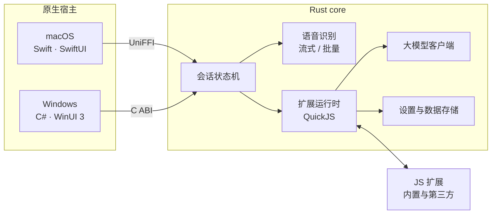

<div align="center">


# 言出 Sayso

**说你正在学的语言，卡住的词用母语补上。**

面向外语学习者的语音输入法。混在句子里的母语会翻译为目标语言后写入，<br>
译文在候选框中高亮、朗读，并可收入生词本，放入本地笔记，甚至自定义处理。


[特点](#特点) · [使用](#使用) · [架构](#架构) · [扩展](#扩展) · [安装](#安装)


</div>

---

## 特点

- **整句翻译，而非逐词替换**：模型重写整句，冠词、语序和主谓一致随之调整。说 `I have a 苹果`，写入的是 `I have an apple.`
- **只标出真正翻译的部分**：译文与原文逐段对应，候选框只高亮实际翻译或修正的片段，并生成「译文 · 原文」词条。
- **纠正识别误写**：识别服务把目标语言的发音误写成母语文字时，结合读音和上下文还原；纠错与翻译在同一次请求中完成。
- **纯外语不经过大模型**：两种语言书写系统不同（如英语与中文）时，纯目标语言的句子在本地判定后直接写入，不增加延迟。
- **8 种语言任意组合**：英、中、日、韩、法、德、西、俄，共 56 种语言对。
- **可扩展**：内置功能本身就是 JavaScript 扩展，同一份扩展在 macOS 与 Windows 上运行。

## 使用

首次启动后，在「设置 → 通用」选择目标语言与本地语言（默认英语与中文），在「模型配置」中填写语音识别与翻译服务。

| | macOS | Windows |
| --- | --- | --- |
| 语音输入 | 按住 <kbd>右 Option</kbd> | 按住 <kbd>右 Ctrl</kbd> |
| 划词翻译 | <kbd>右 Option</kbd> + <kbd>T</kbd> | <kbd>右 Ctrl</kbd> + <kbd>T</kbd> |
| 取消 | <kbd>Esc</kbd> | <kbd>Esc</kbd> |

快捷键与触发方式（按住说话 / 按一下开始）均可在设置中修改。

- **语音输入**：松开按键后写入当前输入框。译文在候选框中高亮并自动朗读一次，点击词条可重听。
- **划词翻译**：在任意应用中选中文字后触发，在目标语言与本地语言之间互译。
- **生词本**：候选框中的词条可单独或全部加入生词本，之后在「设置 → 生词本」中检索、朗读、删除。

### 模型服务

| | 支持 |
| --- | --- |
| 语音识别 | 火山引擎（仅中英混说）、阿里云百炼千问、Soniox（以上为流式识别），以及任意兼容 OpenAI `/audio/transcriptions` 的服务 |
| 翻译 | OpenAI、Claude、DeepSeek、火山方舟、百炼、Kimi、智谱、Gemini、OpenRouter、Ollama，以及自定义 OpenAI 兼容服务 |

API Key 保存在系统钥匙串（Windows 为凭据管理器），不写入配置文件。

> [!TIP]
> 使用本地语音模型：启动兼容 `/audio/transcriptions` 的服务后，在「模型配置 → 语音模型」选择「OpenAI 兼容 / 本地服务」，填写 Base URL（如 `http://127.0.0.1:8000/v1`）与模型名；无需认证时 API Key 留空。

## 架构



- **Rust core** 是设置、识别、翻译、扩展与会话逻辑的运行时公用核心。macOS 通过 UniFFI 绑定调用，Windows 通过一层窄 C ABI 调用，两端行为一致。
- **原生宿主**只提供平台能力与界面：全局热键、录音、读取选区、写入前台应用、系统朗读、密钥存储，以及候选框和设置窗口。
- **扩展**运行在 core 内嵌的 QuickJS 中，通过 `sayso.*` API 往候选框添加内容、读写自己的数据、写入文字或调用已配置的大模型。

代码结构、混说翻译的实现细节与测试方法见 [开发说明](docs/development.md)。

## 扩展

扩展是一个导出事件处理函数的 `main.js`，拿到的输入是统一的文本：可以来自一段语音，也可以来自选中的文字。每个命令可以绑定一个路由键，例如为待办绑定 <kbd>D</kbd> 后，按住入口键说话、松开前按 <kbd>D</kbd>，这句话只会记为待办，不会写入。

扩展需声明所用能力（`blocks` / `store` / `insert` / `llm` / `publish` / `fs`），第三方扩展启用前由用户确认。

| 示例 | 作用 |
| --- | --- |
| [`favorites`](examples/extensions/favorites) | 收藏翻译出的单词，单独页签管理 |
| [`explain`](examples/extensions/explain) | 用已配置的模型讲解一句外语的语法 |
| [`todo`](examples/extensions/todo) | 把说的话或选中的文字记为待办 |
| [`obsidian`](examples/extensions/obsidian) | 把写入的内容追加到 Obsidian 当天的笔记 |

将扩展文件夹放入扩展目录（macOS：`~/Library/Application Support/Sayso/Extensions/`，Windows：`%LOCALAPPDATA%\Sayso\Extensions\`），在「设置 → 扩展」中重新加载并启用。扩展也可导出为 `.sayso` 文件，双击即可安装。协议与 API 见 [扩展协议](docs/extension-protocol.md)。

## 安装

从 [Releases](https://github.com/moayuisuda/Sayso/releases/latest) 下载对应系统的压缩包。

### macOS

需要 macOS 14+ 与 Apple 芯片。解压后将 `Sayso.app` 移入「应用程序」。安装包已用 Developer ID 签名并经 Apple 公证。

启动后按提示授予**麦克风**与**辅助功能**权限（用于全局快捷键、读取选区和写入文字），更新版本后权限保持有效。

### Windows

需要 Windows 10 2004 及以上（x64）。在解压目录中打开 PowerShell 运行：

```powershell
powershell -ExecutionPolicy Bypass -File .\install-windows.ps1 -Source app
```

安装后从开始菜单启动，关闭设置窗口后常驻系统托盘。

- 需在 Windows 设置中允许桌面应用访问麦克风。
- 朗读使用系统语音。缺少对应语言时，从「设置 → 通用 → 朗读 → 管理朗读语音」安装，完成后重启 Sayso。
- 在「已安装的应用」中卸载，卸载前先从托盘退出；设置与数据会保留。

### 从源码构建

- **macOS**：需要 Xcode 26 与 [Rust](https://rustup.rs)，运行 `INSTALL=1 bash scripts/bundle-app.sh`。
- **Windows**：需要 .NET 10 SDK、Rust（MSVC 工具链）、Visual Studio Build Tools 的 C++ 工具与 Windows SDK，运行 `./scripts/build-windows.ps1 -Install`。

发版流程见 [开发说明](docs/development.md#发版)。
