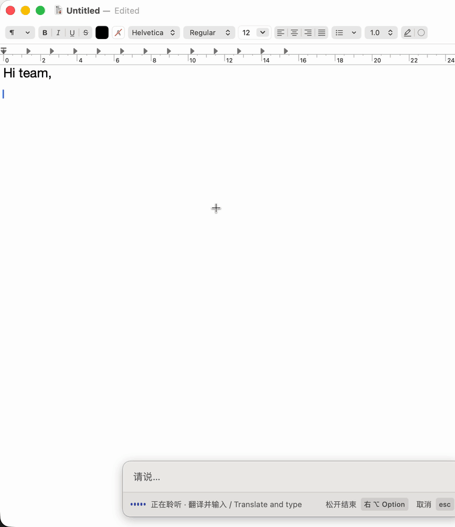

<div align="center">


# 言出 Sayso

**用正在学的语言说话，不会的词，直接说中文。**

给外语学习者的语音输入法。说到一半卡住了，不会的词直接用中文说，<br>
Sayso 会结合上下文翻译好再输入，顺便读一遍给你听，记进生词本。


[怎么用](#怎么用) · [扩展](#扩展) · [安装](#安装) · [开发](docs/development.md)



</div>

---

## 怎么用

第一次打开，先在「设置 → 通用」选好目标语言（默认英语）和本地语言，也就是你的母语（默认中文），再到「模型配置」填好语音识别和翻译模型。

| | macOS | Windows |
| --- | --- | --- |
| 按住说话 | <kbd>右 Option</kbd> | <kbd>右 Ctrl</kbd> |
| 划词翻译 | <kbd>右 Option</kbd> + <kbd>T</kbd> | <kbd>右 Ctrl</kbd> + <kbd>T</kbd> |
| 取消 | <kbd>Esc</kbd> | <kbd>Esc</kbd> |

快捷键和「按住说话 / 按一下开始」都能在设置里改。

### 说话输入

按住入口键说话，松开就输入。比如说「I have a 苹果」，打出来的是 `I have an apple.`。翻译的部分会在候选框里高亮，点一下可以再听一遍。

### 划词翻译

在任何地方选中一段文字，按住入口键再按 <kbd>T</kbd>。英文翻成中文，中文翻成英文。

### 生词本

翻译出来的词会列在候选框里，可以一个个加，也可以一次全加。加过的词在「设置 → 生词本」里查找、朗读、删除。

### 支持的服务

- **语音识别**：火山引擎（仅中英混说）、阿里云百炼千问、Soniox，或任何兼容 OpenAI `/audio/transcriptions` 的服务。
- **翻译**：OpenAI、Claude、DeepSeek、火山方舟、百炼、Kimi、智谱、Gemini、OpenRouter、Ollama，或自定义的 OpenAI 兼容服务。

API Key 保存在系统钥匙串（Windows 上是凭据管理器）里，不会写进配置文件。

> [!TIP]
> 想用本地语音模型，先自己把服务跑起来，然后在「模型配置 → 语音模型」选「OpenAI 兼容 / 本地服务」，填上 Base URL（比如 `http://127.0.0.1:8000/v1`）和模型名；服务不需要认证的话 API Key 留空。

## 扩展

语音翻译、划词翻译和生词本其实都是扩展。你也可以用 JavaScript 写自己的：拿到你说的话或选中的文字，记成待办、存进笔记、讲解语法都行。扩展能直接用你配好的翻译模型，同一份代码在 macOS 和 Windows 上都能跑。

每个功能可以绑一个按键：比如给待办绑上 <kbd>D</kbd>，按住入口键说话、松开前按一下 <kbd>D</kbd>，这句话就只记成待办。

| 示例 | 作用 |
| --- | --- |
| [`favorites`](examples/extensions/favorites) | 收藏翻译出来的单词 |
| [`explain`](examples/extensions/explain) | 讲解一句外语的语法 |
| [`todo`](examples/extensions/todo) | 把说的话记成待办 |
| [`obsidian`](examples/extensions/obsidian) | 把输入的内容追加到 Obsidian 当天的笔记（先在 `config.json` 里填好库目录） |

把文件夹复制到扩展目录（macOS：`~/Library/Application Support/Sayso/Extensions/`，Windows：`%LOCALAPPDATA%\Sayso\Extensions\`），在「设置 → 扩展」里重新加载并启用。

扩展可以在「设置 → 扩展」导出成 `.sayso` 文件，别人双击就能装。想自己写扩展，看 [扩展协议](docs/extension-protocol.md)。

## 安装

从 [Releases](https://github.com/moayuisuda/Sayso/releases/latest) 下载对应系统的压缩包。

### macOS

需要 macOS 14+，Apple 芯片。解压后把 `Sayso.app` 拖进「应用程序」。

安装包没有经过 Apple 公证，第一次打开会被系统拦下：到「系统设置 → 隐私与安全性」底部点「仍要打开」，或者在终端运行：

```bash
xattr -dr com.apple.quarantine /Applications/Sayso.app
```

打开后按提示授予**麦克风**和**辅助功能**权限（后者用于全局快捷键、读取选中文字和输入）。每次更新版本后需要重新授予辅助功能权限。

### Windows

需要 Windows 10 2004 及以上（x64）。解压后在解压目录里打开 PowerShell，运行：

```powershell
powershell -ExecutionPolicy Bypass -File .\install-windows.ps1 -Source app
```

装好后从开始菜单打开。关掉设置窗口后它会留在系统托盘里。

- 需要在 Windows 设置里允许桌面应用使用麦克风。
- 朗读用的是系统语音。缺少对应语言时，从「设置 → 通用 → 朗读 → 管理朗读语音」去安装，装完重启 Sayso。
- 在「已安装的应用」里卸载，卸载前先从托盘退出。卸载会保留设置和数据。

### 从源码构建

- **macOS**：需要 Xcode 26 和 [Rust](https://rustup.rs)，运行 `INSTALL=1 bash scripts/bundle-app.sh`。
- **Windows**：需要 .NET 10 SDK、Rust（MSVC 工具链）、Visual Studio Build Tools 的 C++ 工具和 Windows SDK，在 PowerShell 里运行 `./scripts/build-windows.ps1 -Install`。

## 开发

代码结构、实现细节、测试与发版方法见 [开发说明](docs/development.md)。
